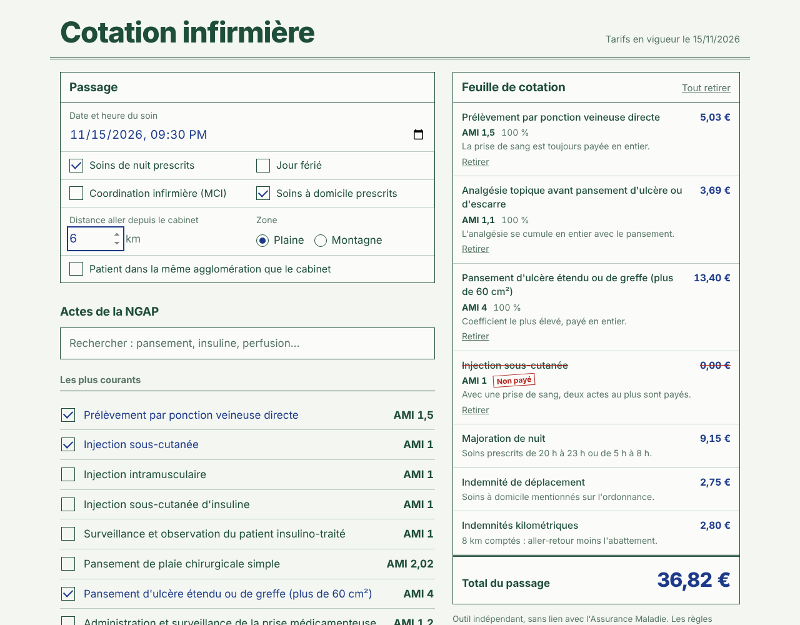

<div align="center">

# ngap-engine

**Explainable billing engine for French independent nurses (NGAP).**

Turn a care session into a compliant, line-by-line quote, with the rule behind every euro.

[](https://github.com/mxbhr/ngap-engine/actions/workflows/ci.yml)


**[▶ Try the web app](https://mxbhr.github.io/ngap-engine/)**: free, no account, works on any phone.

</div>

<p align="center">
  <a href="https://mxbhr.github.io/ngap-engine/"></a>
</p>

---

## Why

Independent nurses in France (*infirmiers libéraux*, IDEL) bill the national health insurance using the **NGAP**, a nomenclature full of cumulation rules, surcharges and travel allowances. A wrong combination means rejected claims, lost revenue or a costly audit.

These rules are documented in guides and training courses, and implemented inside closed-source billing software. **ngap-engine** is an open, tested and explainable implementation that any app can embed.

## Features

- **Full Titre XVI catalog**: 110 nursing acts from chapters I and II, with article, coefficient, usage limits and derogations
- **Article 11B cumulation**: 100 % / 50 % / not billed, with derogations (blood draw, topical analgesia, insulin-treated patients, perfusions, post-operative care)
- **Conflict detection**: acts the nomenclature forbids billing together are reported
- **Surcharges**: single act (MAU), coordination (MCI), night, deep night, Sunday and public holidays, with non-cumulation handled
- **Travel**: flat fee (IFD), mileage (IK) with plain/mountain deductions and the daily cap on cumulated kilometres
- **Versioned tariffs**: every value has an effective date and a source, so past and future dates are priced correctly (AMI 3.15 € → 3.35 € on 7 Nov 2026 → 3.45 € on 1 Nov 2027)
- **Explainable**: each line of a quote carries the rule that produced it
- **Zero dependencies**, integer-cent arithmetic, strict TypeScript
- **Stable rule identifiers** on every line (`11B_SECOND`, `MAU`, `IK`…) so any interface can translate them

## Quick start

```bash
npm install ngap-engine
```

```ts
import { CATALOG, quote, formatEuros } from "ngap-engine";

const q = quote({
  acts: [CATALOG.COMPLEX_DRESSING, CATALOG.SC_INJECTION],
  dateTime: "2026-11-10T09:00",
  homeVisitPrescribed: true,
  trip: { distanceKm: 6, terrain: "plain" },
});

for (const line of q.lines) {
  console.log(line.code, line.coding ?? "", formatEuros(line.amountCents), "—", line.reason);
}
console.log("Total:", formatEuros(q.totalCents));
```

```
COMPLEX_DRESSING AMI 4  13,40 € — Art. 11B: highest coefficient, full rate
SC_INJECTION     AMI 1   1,68 € — Art. 11B: second act, half rate
IFD                      2,75 € — Prescribed home visit
IK                       2,80 € — 8 billable km (plain), before daily cap
Total: 20,63 €
```

## Catalog

```ts
import { ACTS, ARTICLES, findAct } from "ngap-engine";

findAct("INSULIN_INJECTION"); // { letter: "AMI", coefficient: 1, article: "XVI-II-5bis", ... }
```

The catalog follows the NGAP version in force in July 2026 (Titre XVI). Every act can also be described by hand:

```ts
const act = {
  code: "MY_ACT",
  label: "Description of the act",
  letter: "AMI",
  coefficient: 3,
  alwaysFullRate: false,      // art. 11B derogation
  fullRateGroup: undefined,   // e.g. "art5bis"
  perfusion: undefined,       // "short" | "long"
};
```

## Daily mileage cap

Mileage is capped on the kilometres a nurse cumulates over a day, so it is computed across all trips:

```ts
import { dailyMileage } from "ngap-engine";

dailyMileage("2026-11-10", [
  { distanceKm: 53, terrain: "plain" },
  { distanceKm: 53, terrain: "plain" },
  { distanceKm: 53, terrain: "plain" },
]);
// km 1-299 at full rate, km 300-399 at 50 %, nothing from km 400
```

## Roadmap

- [ ] Dependent-patient packages (BSA, BSB, BSC) and their specific cumulation rules
- [x] Full Titre XVI act catalog
- [ ] Automated cross-check against the NGAP CSV published on data.gouv.fr
- [ ] Child surcharge (MIE) and remaining derogations
- [x] Web app for nurses ([live](https://mxbhr.github.io/ngap-engine/))
- [ ] REST API
- [ ] Rule changes from Avenant 11 scheduled for 2027 and 2028

Contributions from nurses, billing experts and developers are welcome: open an issue with the rule, its legal reference and an example.

## Disclaimer

This project is not affiliated with the Assurance Maladie. Values and rules are implemented from public sources and must be checked against the official NGAP before being used for real billing. Each tariff in [`src/tariffs.ts`](src/tariffs.ts) lists its source.

## License

MIT © Maxime Behr
